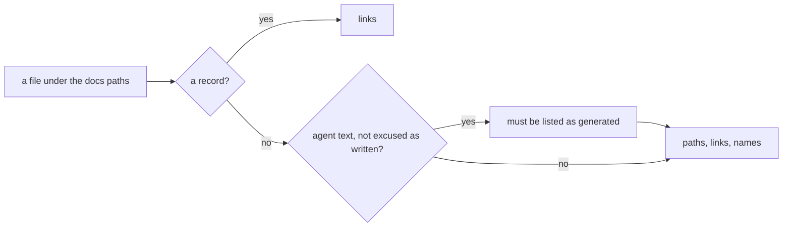
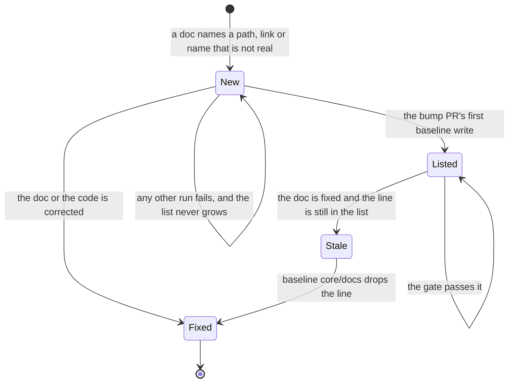
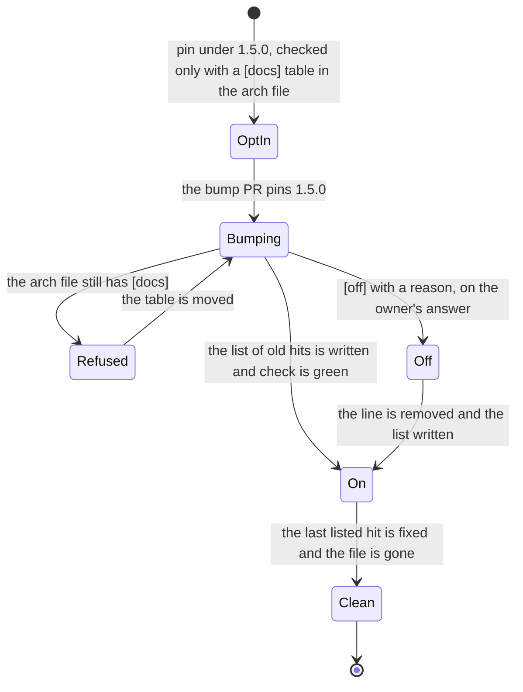

# The docs gate: module boundaries and statecharts (#83)

## Where the code goes

`arch/docs.rs` splits in two and moves; three parts are new.

```
crates/gatekeeper-model/src/docs.rs          new: the [docs] types of shapes.md and the fixed lists
crates/gatekeeper-model/src/lib.rs           Config gains `docs`
crates/gatekeeper-engine/src/check/docs.rs   new: the entry; joins the parts' findings (collected; mod.rs is generated)
crates/gatekeeper-engine/src/docs/           new folder (collected), each file one job
    mod.rs          the module list
    scope.rs        which files are docs, each one's class; an excuse that matches no file
    text.rs         a doc's backticked spans and links, outside code blocks: the one reader of markdown
    paths.rs        stale paths and broken links      (from arch/docs.rs: `stale`, `missing_path`)
    watch.rs        a watched key with no doc line     (from arch/docs.rs: `undocumented`)
    names.rs        the names list: run or read, parse, claims, descriptions
    generated.rs    agent text and the names file are listed as generated
crates/gatekeeper-engine/src/arch/docs.rs    deleted
crates/gatekeeper-engine/src/arch/config.rs  `docs` refused with the new home; `generated()` added
crates/gatekeeper-engine/src/check/arch.rs   the docs lines and the PR body read removed
crates/gatekeeper-engine/src/run/cx.rs       RunCtx and CheckCx gain `docs`
packs/core/gates/docs.toml                   new: gate core/docs
packs/core/fixtures/docs/<case>/             new: the cases of cases.md; five move here from fixtures/arch
```

## Who may call whom

| Module | May use | Never |
|---|---|---|
| `check/docs.rs` | `docs/*`, `CheckCx`, `arch::config::generated`, `arch::frozen::diff` | reading a file or the config itself |
| `docs/scope.rs` | the model, `arch::{walk, any}` | the names list |
| `docs/text.rs` | nothing but the text it is given | the file system beyond the one doc |
| `docs/paths.rs`, `docs/watch.rs` | the model, `text`, files under the repo root, the runner for `git check-ignore` | the names list |
| `docs/names.rs` | the model, `text`, the runner for the repo's `run` command | the network; the environment |
| `docs/generated.rs` | the model, the globs it is given | running `generate`: freshness is `core/arch`'s |
| `arch/*.rs` | as today | `docs/*` |
| the model's `docs.rs` | serde, `Glob` | the engine |

Rules that follow, each with its enforcer:

- **arch never calls the docs gate.** Enforcer: the `docs::` ban on `arch/**` in gatekeeper's arch file
  (`adr.md`, last section).
- **One reader of markdown.** Path, link and name checks take spans from `text.rs`, so a code block is skipped the
  same way for all three. Enforcer: review of S1; the `in-a-code-block` case covers paths and names.
- **The check reads no environment and no config file.** Enforcer: the existing `env::var` ban; the table reaches
  it typed, through `CheckCx`.
- **The docs gate never runs the generator.** It checks the listing; `core/arch` checks the bytes. Enforcer:
  `generated.rs` takes globs and paths only, with no runner in its use list (review of S3).
- **A repo cannot narrow the defaults without a reason.** Enforcer: the config type has no key that removes a
  path; `[off]` refuses an empty reason today; `Reason` refuses one in `[docs.records]` and `[docs.written]`.
- **A names file is generated.** Enforcer: the `names-file-not-generated` case.

## A doc's class decides its checks



## A hit's life



`Listed` is entered once per repo, at the bump. After that the only way into the list is to delete the file and
write it again, which is an owner's call, as for any gate's baseline.

## A repo's gate



A repo with a table keeps it until the PR that moves it, and the same PR turns the wider defaults on. One thing
is checked less after it: drover's records lose their path check (`adr.md`, open question 1, answered: links only).
