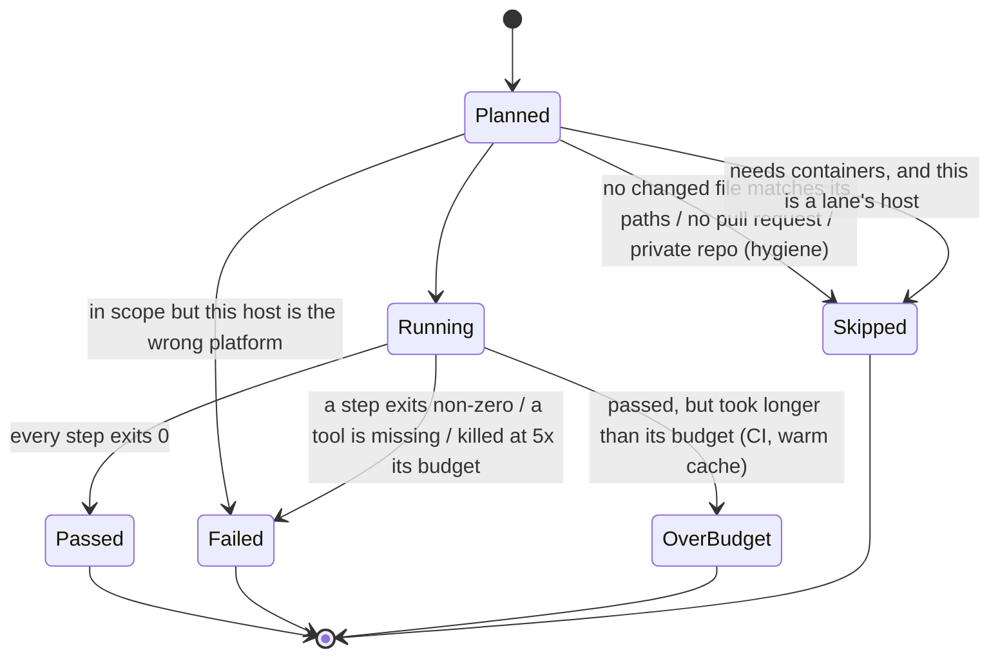
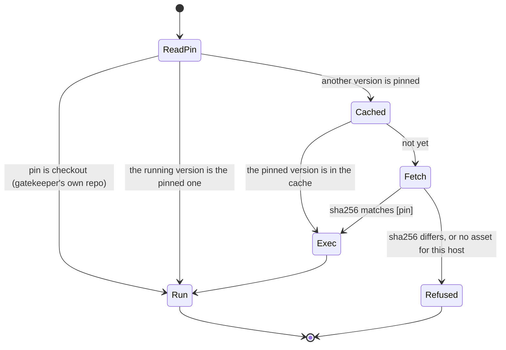
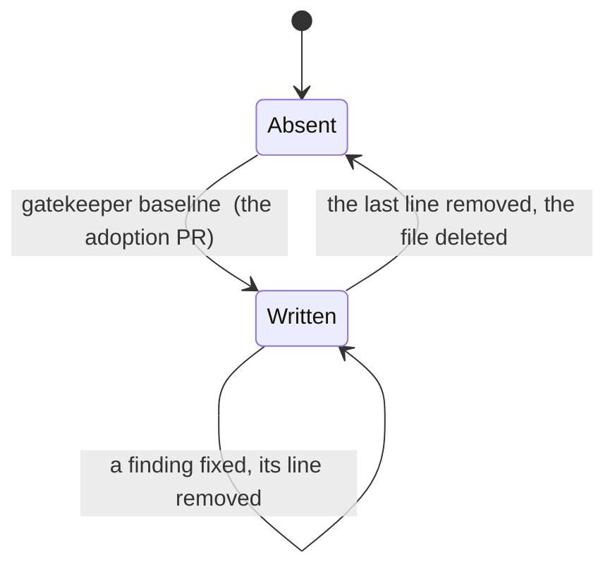

# gatekeeper: module boundaries and statecharts (#1)

## The repo

```
crates/gatekeeper-model/     the types of shapes.md; no I/O
crates/gatekeeper-engine/    plan, run, report, tools, pin, baseline, the embedded packs
  src/check/<name>.rs        one built-in check a file (floor checks, fixture run, token lint, pin check)
  src/runner.rs              the only place a process starts
  src/fetch.rs               the only place a download happens (sha256 checked before use)
crates/gatekeeper/           the binary: arguments in, text and exit code out
  src/cmd/<verb>.rs          one verb a file
packs/<pack>/pack.toml       core, rust, swift, ts, supabase
packs/<pack>/gates/<gate>.toml
packs/<pack>/fixtures/<gate>/<case>/
packs/<pack>/files/          what a gate hands its tool: clippy.toml, the lint floor, the oxlint config
packs/<pack>/tools/<tool>.toml
packs/<pack>/scripts/        pack scripts (release signing, the migration apply and status)
packs/swift/anti-slop/       the one anti-slop-swift, built per release and shipped as a tool asset
.github/workflows/           gates.yml, release.yml, testflight.yml, supabase-deploy.yml, ci.yml (calls gates.yml)
skill/gatekeeper/            generated from the gate files
```

## Who may call whom

| Module | May use | Never |
|---|---|---|
| `gatekeeper-model` | nothing | files, processes, the network, the clock |
| `gatekeeper-engine` | `gatekeeper-model` | printing to the terminal; reading `argv` or the CI environment |
| `gatekeeper` (cli) | engine, model | starting a process or a download itself |
| `packs/**` | nothing: data and scripts only | Rust code; a path into another pack |
| `.github/workflows/gates.yml` | the bootstrap script, `gatekeeper ci plan`, `gatekeeper check`, `gatekeeper ci done`, toolchain setup actions | any gate command (`cargo`, `tsc`, `swift`, a linter) |
| a consumer repo | `gatekeeper` verbs, the four workflows by tag | a copy of a pack file; a CI step beside the gates job |

Rules that follow, each with its enforcer:

- **A gate is a file, not a list entry.** The engine embeds `packs/**` and globs it; no registry names a gate.
  Enforcer: `selftest` fails a gate with no failing fixture, so an unlisted gate cannot exist quietly.
- **The workflow holds no gate logic.** Enforcer: an arch-check ban on `cargo ` in `gates.yml`; the CI-only parts
  are provisioning (toolchain, cache) and nothing else.
- **A pack calls a drover concept through drover.** Line cap, arch-check, hygiene, PR body and the rules file are
  `Tool { tool: drover }` steps. gatekeeper never re-implements one. Enforcer: review against this table.
- **One pinned version of every tool.** drover, actionlint, cargo-deny, oxlint, knip and anti-slop-swift are
  fetched by `fetch.rs` from `packs/*/tools/*.toml`, on a lane's host and on a runner alike. The repo's own
  toolchains (Rust from `rust-toolchain.toml`, Node from `.node-version`, Xcode) are the repo's.
- **The cli parses, the engine decides.** The CI environment (event, base, PR body, cache hit) is read once in
  `cmd/ci.rs` and passed in as typed values.

## A gate's run



- A skip is always printed with its reason. Nothing is skipped silently.
- A gate that is in scope but cannot run on this host fails locally (`needs macos`): a green local check must
  mean a green CI. Queue such issues to a host of that platform.
- The one planned gap is `Skip::CiOnly(Containers)`: a lane's hook refuses containers, so the pgTAP gate runs in
  CI only (open question 2).
- The budget is enforced only where it is comparable: in CI with a warm cache (`BudgetMode::Enforce`). A cold
  cache waives it and says so; a lane's host only reports the time.

## Which gatekeeper runs



The runner's bootstrap does the same from the same `[pin]`, so CI and the lane run one binary.

## A baseline



There is no arrow that adds a line after the first write. A new finding is fixed, never listed.

## A release of gatekeeper

A tag `vX.Y.Z` is cut from `main` by gatekeeper's own `release.yml` (the shared one, called at this commit). Tags
are never moved or reused; a bad release is replaced by the next patch. `packs/**`, the workflows and the binary
ship from one commit, so `gates.yml@v1.2.0` always runs gates of 1.2.0 (`core/pin` holds the consumer to that).
