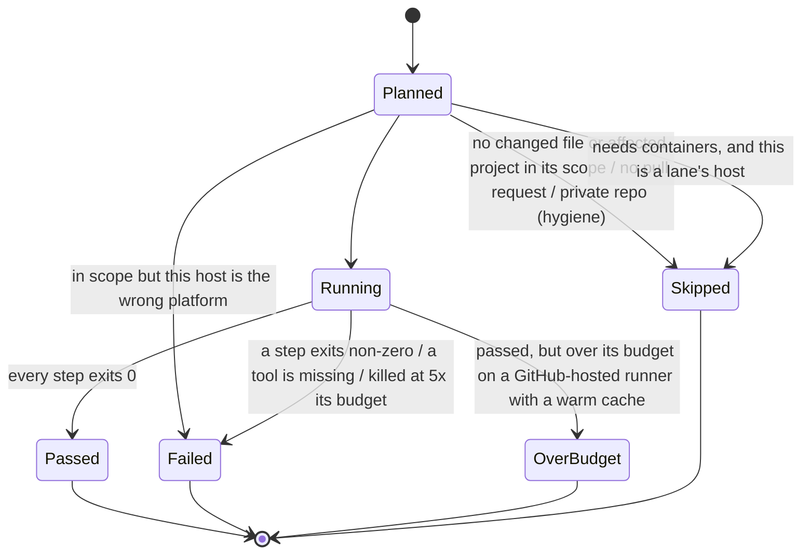
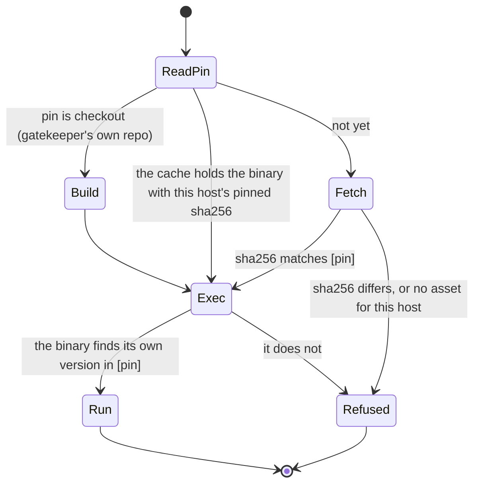
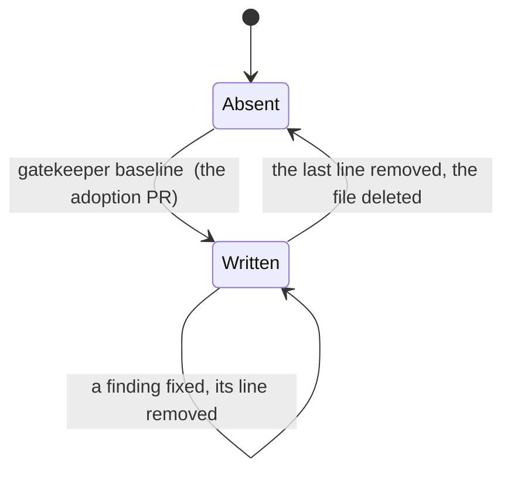

# gatekeeper: module boundaries and statecharts (#1)

## The repo

```
crates/gatekeeper-model/     the types of shapes.md; no I/O
crates/gatekeeper-engine/    plan, run, report, tools, pin, baseline, the embedded packs
  src/check/<name>.rs        one built-in check a file (floor checks, fixture run, token lint, pin check)
  src/scope.rs               affected projects: a graph and a change in, a set out (G10)
  src/graph/<kind>.rs        one workspace reader a file: pnpm, cargo, swiftpm (G10)
  src/runner.rs              the only place a process starts
  src/fetch.rs               the only place the program downloads (sha256 checked before use)
crates/gatekeeper/           the binary: arguments in, text and exit code out
  src/cmd/<verb>.rs          one verb a file
packs/<pack>/pack.toml       core, rust, swift, ts, supabase
packs/<pack>/gates/<gate>.toml
packs/<pack>/fixtures/<gate>/<case>/
packs/<pack>/files/          what a gate hands its tool: clippy.toml, the lint floor, the oxlint config
packs/<pack>/tools/<tool>.toml
packs/<pack>/scripts/        pack scripts (release signing, the migration apply and status)
packs/core/files/run         the wrapper every consumer holds as `.gatekeeper/run`
packs/swift/anti-slop/       the one anti-slop-swift, built per release and shipped as a tool asset
release.pub                  the public half of the release signing key, compiled in
.github/workflows/           gates.yml, release.yml, testflight.yml, supabase-deploy.yml, ci.yml (calls gates.yml),
                             tools.yml (builds each tool file's [build] once per version)
skill/gatekeeper/            generated from the gate files
```

## Who may call whom

| Module | May use | Never |
|---|---|---|
| `gatekeeper-model` | nothing | files, processes, the network, the clock |
| `gatekeeper-engine` | `gatekeeper-model` | printing to the terminal; reading `argv` or the CI environment |
| `gatekeeper` (cli) | engine, model | starting a process or a download itself |
| `packs/**` | nothing: data and scripts only | Rust code; a path into another pack |
| the wrapper | `curl`, a sha256 tool, the cache, `cargo build` under `pin = "checkout"` | any gate; any decision but which binary to run |
| `.github/workflows/gates.yml` | the consumer's `.gatekeeper/run` (`ci plan`, `check`, `ci done`), toolchain setup actions, artifact upload and download | any gate command (`cargo`, `tsc`, `swift`, a linter) |
| `.github/workflows/release.yml` | `gatekeeper release sign`, the pinned `farrier` and signing tool, the GitHub release | publishing before the checker passed; adding an asset after |
| a consumer repo | the wrapper's verbs; the four workflows by commit sha, secrets by name | a copy of a pack file; a CI step beside the gates job; `secrets: inherit` |

Rules that follow, each with its enforcer:

- **A gate is a file, not a list entry.** The engine embeds `packs/**` and globs it; no registry names a gate.
  Enforcer: `selftest` fails a gate with no failing fixture, so an unlisted gate cannot exist quietly.
- **The workflow holds no gate logic.** Enforcer: an arch-check ban on `cargo ` in `gates.yml`; the CI-only parts
  are provisioning (toolchain, cache, artifacts) and nothing else.
- **A pack calls a drover concept through drover.** Line cap, arch-check, hygiene, PR body and the rules file are
  `Tool { tool: drover }` steps. gatekeeper never re-implements one. Enforcer: review against this table.
- **The release contract is farrier's.** gatekeeper runs the released `farrier` tool and links none of its
  crates. A check on a release is added in farrier, never in `release.yml`. Enforcer: review against this table.
- **One pinned version of every tool.** drover, farrier, actionlint, cargo-deny, oxlint, knip and anti-slop-swift
  are fetched by `fetch.rs` from `packs/*/tools/*.toml`, on a lane's host and on a runner alike. The repo's own
  toolchains (Rust from `rust-toolchain.toml`, Node from `.node-version`, Xcode) are the repo's. A tool with no upstream
  binary has a `[build]` table in its tool file; `tools.yml` builds it once per version and recipe, publishes it
  with a `SHA256SUMS` and never replaces it; a `run` line names it as `{tool:<name>}`.
- **One wrapper.** The file in a consumer equals `packs/core/files/run` of its pinned version. Enforcer:
  `core/pin`.
- **The cli parses, the engine decides.** The CI environment (event, base, PR body, cache hit, runner kind, the
  job's start) is read once in `cmd/ci.rs` and passed in as typed values.
- **Selection is pure.** `scope.rs` takes a graph and a change and does no I/O; the readers in `graph/` do the
  reading. Enforcer: its tests run on fixture graphs, one folder a case (`packs.md`).

## A gate's run



- A skip is always printed with its reason. Nothing is skipped silently.
- A gate that is in scope but cannot run on this host fails locally (`needs macos`): a green local check must
  mean a green CI. Queue such issues to a host of that platform.
- The one planned gap is `Skip::CiOnly(Containers)`: a lane's hook refuses containers, so the pgTAP gate and a
  monorepo's database legs run in CI only (the owner's decision).
- The budget fails a gate only where times are comparable: a GitHub-hosted runner with a warm cache. A self-hosted
  runner, a cold cache and a lane's host mark the gate `slow` and pass it.
- A gate's kept files are collected after its last step, pass or fail.

## Which gatekeeper runs (the wrapper)



A lane's host and a runner go through this same file from the same `[pin]`, so they run one binary, and no host
has an install to keep. The binary re-reads `[pin]` with its own parser, so a wrapper that misread it is caught.

## A release through `release.yml`

```mermaid
stateDiagram-v2
    [*] --> Building: CI green on a release branch
    Building --> Built: each target built; macOS signed and notarized; the checker passes the job's own asset
    Building --> Built: a target failed and allow-partial is set
    Building --> Stopped: a build, a signature or the checker failed
    Built --> Listed: SHA256SUMS names exactly the assets that are there
    Listed --> Signed: SHA256SUMS.minisig, its comment naming the repo, the tag and the commit
    Signed --> Verified: farrier release verify passes the whole folder
    Signed --> Stopped: the checker rejects it
    Verified --> Published: the release is created with every asset in one call
    Verified --> [*]: publish is false (gatekeeper's dry run)
    Published --> [*]
    Stopped --> [*]
```



Nothing is public before `Verified`, and nothing changes after `Published`. Order across repos: farrier publishes
first with its own workflow, since this one needs a released checker; gatekeeper is the first repo it releases.

## A baseline



There is no arrow that adds a line after the first write. A new finding is fixed, never listed.

## A release of gatekeeper

A push to `main` whose workspace version has no tag yet is released as `vX.Y.Z` by gatekeeper's own `release.yml`
(the shared one, called at this commit). Tags are never moved or reused; a bad release is replaced by the next
patch. `packs/**`, the workflows, the wrapper and the binary ship from one commit, and a consumer names that
commit in `uses:`, so `gates.yml` at 1.2.0 always runs gates of 1.2.0 (`core/pin` holds the consumer to that).
