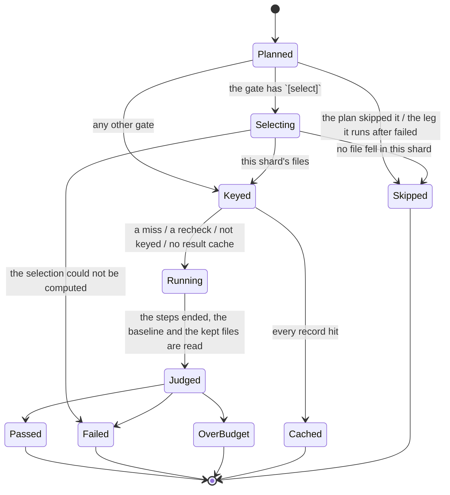

# Hotspots, week of 2026-11-16: module boundaries and the statechart (#67)

## Where the code goes

```
crates/gatekeeper-engine/build.rs            also lists src/skill/topics/ into OUT_DIR/topics.rs
crates/gatekeeper-engine/src/
  skill.rs           frozen. SkillFile, files(), write(), rerun, example_path; SKILL.md's opening, topics, pack list
  skill/
    topics/*.md      collected. One file a feature: what a lane must know to read, fix and rerun it
    pack.rs          packs/<pack>.md: a gate's entry
    example.rs       examples/<gate>.md: a fixture case told in words
    tools.rs         SKILL.md's "Pinned tools" section
  run.rs             shared, at most 150 lines. run(): the jobs and report.json; one(): the layers round a gate
  run/
    cx.rs            RunCtx and RunCtx::lane, CheckCx, out_dir, default_base, platform
    gate.rs          one gate's run: its log, its deadline, each step, the baseline, the kept files, the report
    line.rs          a run line's places, a tool step's arguments, a pack's folders, script
crates/gatekeeper-model/src/report.rs        GateReport::unrun, Millis from a Duration
```

Every public path stays: `run::{RunCtx, CheckCx, run, out_dir, default_base, platform, script}`, `skill::{SkillFile,
files, write}`, and `crate::run::gate` for `selftest`. The twelve check files and four of the five verbs that use
`run` are not touched; `check` is, where it builds the context.

## What opens which file

| A pull request that | Opens | No longer opens |
|---|---|---|
| documents a feature for lanes | its own `skill/topics/<topic>.md` | `skill.rs` |
| changes a pack page or an example page | `skill/pack.rs` or `skill/example.rs` | `skill.rs` |
| gives a run a new input | `run/cx.rs`, and the one caller that sets it | `selftest.rs`, four test files |
| reports something new for a gate | the model's `report.rs`, and its own module | `run.rs`, twice |
| gives a run line a new place | its own module, which hands the place over | `run.rs` |
| adds a kind of step, or changes how a step runs | `run/gate.rs` | |
| wraps a gate's run in a new layer | its own module, and `one()` in `run.rs` | |

The last row is the only one that still meets in `run.rs`. That is why the file is `shared` and not frozen: the
order of the layers is one decision and reads best in one function.

## Who may call whom

| Module | May use | Never |
|---|---|---|
| `skill` (`skill.rs`) | `skill::pack`, `skill::example`, `skill::tools`, the embedded topics, `packs` | holding a feature's text |
| `skill::pack`, `skill::example`, `skill::tools` | `skill`'s two helpers (`rerun`, `example_path`), `packs`, `selftest` (cases), `fetch` (tool files), the model | files, processes; each other |
| `run` (`run.rs`) | `select::pick`, `select::reported`, `cache::gate`, `run::gate`, `kept::receive` | running a step; filling a run line |
| `run::gate` | `run::line`, `runner`, `baseline`, `kept`, `fetch` | `select` or `cache` beyond the `Picked` it is handed |
| `run::line` | `packs` (a pack's folders), `fetch`, `runner` (for `script`) | knowing which feature a place belongs to |
| `run::cx` | `fetch` (a check's tool), `runner` (git, for `default_base`) | the plan, the steps |
| `select`, `cache` | `RunCtx` to read, `Vars`, the model's `GateReport::unrun` | `run::gate` and `run::line` directly: they get a closure |
| `selftest` | `run::gate`, `RunCtx::lane` | `run::run`: a fixture case is one gate, no layers |
| the cli, the tests | `run::{RunCtx, run, out_dir, default_base, platform, script}` | writing `RunCtx` out field by field |

Rules that follow, each with its enforcer:

- **A feature's text is a file, not a line in `skill.rs`.** Enforcer: `frozen` in `.drover/arch.toml`, read by
  the gate `core/arch`: a hunk that adds more lines to `skill.rs` than it removes fails.
- **The checked-in skill is what the binary writes.** Enforcer: as today, `skill/gatekeeper/**` under `generated`
  and the test `skill_to_writes_this_versions_skill_equal_to_the_checked_in_one`.
- **A new input cannot break a caller that does not use it.** Enforcer: the compiler, by `#[non_exhaustive]` on
  `RunCtx`.
- **A report's fields are named in one place.** Enforcer: the compiler, by `#[non_exhaustive]` on `GateReport`.
- **`run.rs` stays the loop and the layers.** Enforcer: its own `[[size]]` rule, 150 lines, in `core/arch`.

## One planned gate, and who owns each step

The states and outcomes are today's. The chart is here because it is the map of `one()`: a new layer is a new
state between two of these, in its own module.



| Step | Owner |
|---|---|
| `Planned` to `Skipped`; the order of everything below | `run.rs` |
| `Selecting` and its three ways out; the selection and the file times added to the report at the end | `select` |
| `Keyed`, `Cached`; writing the record after `Judged`; a recheck that fails | `cache` |
| `Running` to `Judged`, and the outcome | `run/gate.rs`, with the model's `judge` |

- `selftest` enters at `Running`: it calls `run::gate` for one fixture case, with no selection and no cache.
- With no `[cache]`, `Keyed` goes straight to `Running`.
