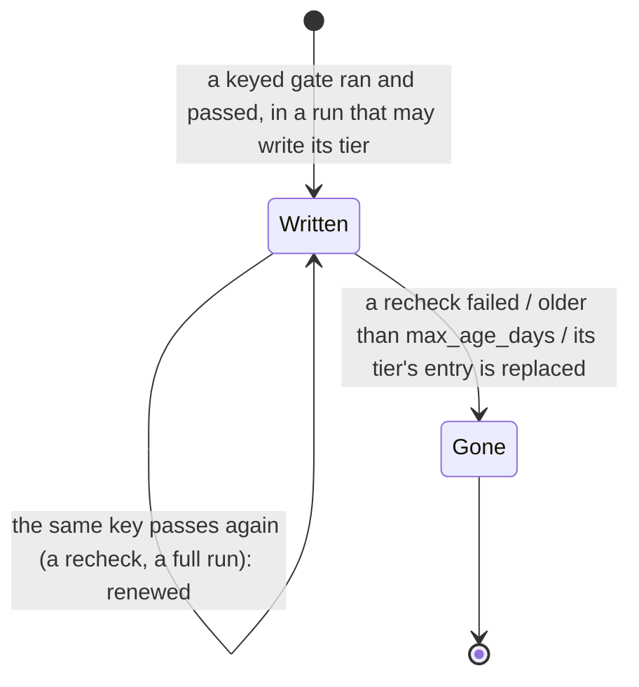

# The result cache: module boundaries and the statechart (#17)

## Where the code goes

```
crates/gatekeeper-model/src/cache.rs        the types of shapes.md; no I/O
crates/gatekeeper-engine/src/cache/
  mode.rs      trigger and config in, CacheMode out; pure
  key.rs       a gate's parts in, Keyed out; pure
  lookup.rs    the found records in, Lookup out; pure (refusals, age, the recheck sample)
  inputs.rs    the worktree's files and their hashes, read once a run through git
  versions.rs  the probe commands, each run once a run
  store.rs     the only place a record is read or written
crates/gatekeeper-engine/tests/cache/<case>/case.toml    one folder a case (cases.md)
crates/gatekeeper/src/cli.rs                reads the trigger from the CI environment, once
.github/workflows/gates.yml                 restores and saves the store folder; decides nothing
```

No list names a case, a tier or a probe: cases are globbed, tiers are the `Scope` enum, a toolchain's probe sits
on `Toolchain`.

## Who may call whom

| Module | May use | Never |
|---|---|---|
| `model::cache` | nothing | files, processes, the clock |
| `cache::mode`, `cache::key`, `cache::lookup` | the model, `sha2` | files, processes, the clock, the environment: time and salt are passed in |
| `cache::inputs`, `cache::versions` | `runner` (git, the probes) | the store |
| `cache::store` | `std::fs` under the store folder | deciding a hit; any path outside the store |
| `run` | `cache::*`: key, look up, run or skip, record | writing a record itself; recording anything but a pass that ran |
| `plan` | `cache::mode` only, for the `ci plan` strings | reading a record: the plan stays pure, a hit is decided in the leg that would run the gate |
| `selftest` | `run` with `CacheMode::Off` | reading or writing the store: a fixture always runs |
| the cli | `cache::mode` with the `Trigger` it read | computing a key; touching the store |
| `gates.yml` | cache restore and save of the folder, by the two strings `ci plan` gave | choosing who reads or writes; a condition on the event or the branch |

Rules that follow, each with its enforcer:

- **One declaration of what a gate reads.** Path scope and the key call the same function for a gate's input
  globs (`paths`, the pack's `always`, `.gatekeeper/**`). Enforcer: the case `always-file-changes`, which
  must both put the gate in scope and miss.
- **Only a pass that ran is recorded.** `store::write` takes a `Ran`, a type only `run` builds from
  `Outcome::Passed`; a `Cached` outcome and a failure cannot be passed to it. Enforcer: the type, and the cases
  `failure-is-not-recorded` and `hit-writes-nothing`.
- **The engine does not read the environment.** Enforcer: the `env::var` ban below.
- **The store is touched in one file.** Enforcer: the `results` path is built only in `store.rs`; review against
  this table.
- **The workflow only moves a folder.** Enforcer: the ban on `github.event_name` in `gates.yml` below.

## A gate's run, with the cache

```mermaid
stateDiagram-v2
    [*] --> Planned
    Planned --> Skipped: out of scope / CI only (as today)
    Planned --> Running: cache off for this run, or the gate has no key
    Planned --> Keyed: the run reads or writes, and the gate has a key
    Keyed --> Running: miss / the record is refused / this run only writes
    Keyed --> Cached: hit, not sampled
    Keyed --> Rechecking: hit, sampled (one in `recheck`)
    Rechecking --> Passed: passes again (the record is renewed)
    Rechecking --> Failed: fails. "cached pass does not hold"; the record is deleted
    Running --> Passed: every step exits 0
    Running --> Failed: a step exits non-zero / a tool is missing / killed at 5x its budget
    Running --> OverBudget: passed, over budget on a GitHub-hosted runner with a warm cache
    Passed --> Recorded: the run may write, and the gate has a key
    Passed --> [*]
    Recorded --> [*]
    Cached --> [*]
    Failed --> [*]
    OverBudget --> [*]
    Skipped --> [*]
```



- There is no arrow from `Cached` to `Recorded`: a hit proves nothing new, so a record's proof is always a run
  that ran the gate.
- There is no arrow from `Failed` or `OverBudget` to `Recorded`.
- A refused record is printed and counted, and the gate runs: a bad record can cost time, never a green.
- `Rechecking` runs the gate in the same tree, as any run does. The same key with a different result is the
  proof of an undeclared input.

## A record's life



In CI the integration tier is replaced whole by each push to the integration branch: it holds what that one run
proved, never a pile. A pull request's tier ends with the pull request.
