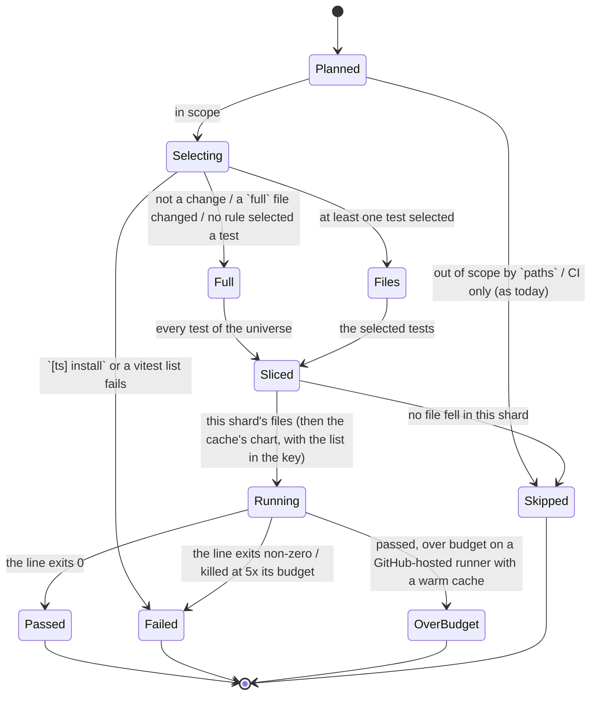
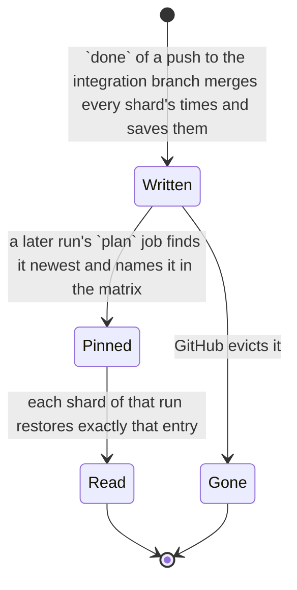

# Per-file test selection: module boundaries and the statecharts (#46)

## Where the code goes

```
crates/gatekeeper-model/src/select.rs        the types of shapes.md; no I/O
crates/gatekeeper-engine/src/select/
  rules.rs     the union: trigger, [select] and evidence in, Selection out; pure
  readers.rs   the text rules: path, basename token, walker, project root, import specifier; pure
  split.rs     files, timings and a shard in, the slice out; pure
  vitest.rs    the only place that finds and runs the repo's vitest: the universe, the closure, the JSON report
  mod.rs       one gate's selection: install, gather the evidence, select, split, note, selection.json
  replay.rs    runs in, Replay out: a scratch worktree per run
crates/gatekeeper/src/cmd/replay.rs          the verb; parses `--runs`, prints the table
crates/gatekeeper-engine/tests/select/<case>/case.toml    one folder a case (cases.md)
.gatekeeper/gates/select-vitest.toml         gatekeeper's own gate: the same cases against a real vitest
.github/workflows/gates.yml                  looks up, restores and saves the timings folder; decides nothing
```

`run.rs` is at 377 of its 400 lines. The selection wraps a gate's run from `select/mod.rs`, the way
`cache::gate` does, and `run.rs` gains the one call.

No list names a case, a rule or a reason: cases are globbed, reasons are the `Why` enum, the walker tokens are
one constant in `readers.rs`.

## Who may call whom

| Module | May use | Never |
|---|---|---|
| `model::select` | nothing | files, processes |
| `select::rules`, `select::readers`, `select::split` | the model | files, processes, git, vitest: all evidence is passed in |
| `select::vitest` | `runner` | deciding what is selected; any rule |
| `select` (`mod.rs`) | `rules`, `split`, `vitest`, `runner` (git, `[ts] install`), the tree's test files | running the gate's own line; the result store |
| `run` | `select` for a `[select]` gate, then `cache` and the gate's line as today | reading vitest's output itself |
| `cache::key` | the slice's file list, as one more part | selecting |
| `plan` | nothing of `select`: the plan stays pure and never sees the change | running vitest; reading timings |
| `ci` | `Selected` in the reports (the agreement check, the summary), the merged timings | selecting; splitting |
| `select::replay` | `select` (`mod.rs`), `runner` (git worktrees, the `--other` command) | running a test; writing outside `target/gatekeeper/replay` |
| `selftest` | nothing of `select`: no pack gate selects | |
| the cli | `select::replay`; passes `--timings` through | selecting |
| `gates.yml` | cache lookup, restore and save of the timings folder, by the strings `ci plan` gave | a condition on the event or the branch |

Rules that follow, each with its enforcer:

- **The rules are pure.** Enforcer: the two bans on `runner::` and `fs::` in `rules.rs`, `readers.rs` and
  `split.rs` (`adr.md`, the last section), so every case runs with no vitest and no git.
- **One module runs vitest.** Enforcer: the ban on `.bin/vitest` outside `select/vitest.rs`.
- **A stub cannot drift from vitest.** Each case declares the closure vitest must return; the pure test uses it
  as input, `select-vitest` asserts a real vitest returns it. Enforcer: that gate.
- **An empty selection cannot be built.** Enforcer: the type, and the case `empty-means-full`.
- **Shards run one list.** Enforcer: `ci done`'s digest check, and the plan case `shards-disagree`.
- **The workflow only moves a folder.** Enforcer: the existing ban on `github.event_name` in `gates.yml`.

## A `[select]` gate's run



- There is no arrow from `Selecting` to `Skipped`: a gate in scope whose rules select nothing runs everything.
- A failed selection fails the gate. It never falls back to a narrower list.
- From `Sliced` on, the result cache works as in `../result-cache/boundaries.md`; a hit skips this job's slice.
- Selecting is inside the gate's time and its budget.

## A timings entry's life



- Only a push to the integration branch writes: it ran every test, so its times are complete, and a pull
  request cannot write an entry another run reads.
- A run with no entry splits every file at the same default time. Its shards still agree.
- Timings change how even the shards are, never which tests run: the split is a partition for any timings.
